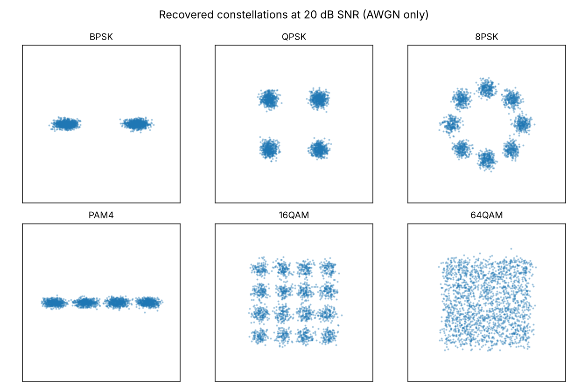

# RF modulation classifier

Identify the modulation scheme of a radio signal from raw IQ samples, using a
1D CNN, and show honestly where it beats classical signal processing and where
it does not.

The deliverable is a 130 KB int8 model that classifies a 512-sample burst in
**0.10 ms on one CPU core** at **93.3% accuracy above 10 dB SNR**, against
**78.6%** for a cumulant-based classical baseline.


---

## Why this problem

A receiver that does not know what it is listening to has to work out the
modulation before it can demodulate anything. That matters for spectrum
monitoring, for interference hunting, for cognitive radio, and for any
software-defined radio that has to cope with signals it was not configured
for. It is a real task with a real classical solution, which makes it a fair
place to ask whether a neural network earns its keep.

Six schemes are classified: **BPSK, QPSK, 8PSK, PAM4, 16QAM, 64QAM**.

## Results

All numbers are on a held-out test split of 24,000 bursts the model never saw,
balanced across all six schemes and all 16 SNR points.

| Model | Overall | SNR ≥ 10 dB | Size | p50 latency |
|---|---:|---:|---:|---:|
| Cumulant features + gradient boosting | 0.539 | 0.786 | — | — |
| CNN (PyTorch fp32) | 0.761 | 0.932 | — | — |
| CNN (ONNX fp32) | 0.761 | 0.932 | 443 KB | 0.40 ms |
| **CNN (ONNX int8)** | **0.761** | **0.933** | **130 KB** | **0.10 ms** |

Chance is 0.167. Latency is single-example, single-threaded, measured over 300
runs after warm-up.

### A single accuracy number here would be meaningless

Accuracy depends almost entirely on which SNRs you average over. Quote a model
tested only at 20 dB and it looks superb; quote the same model averaged down
to −10 dB and it looks broken. Both are the same model. So every result in
this repo is reported per SNR:

| SNR (dB) | Cumulant + GBM | CNN (int8) |
|---:|---:|---:|
| −10 | 0.157 | 0.292 |
| −6 | 0.207 | 0.439 |
| −2 | 0.299 | 0.679 |
| +2 | 0.504 | 0.820 |
| +6 | 0.627 | 0.881 |
| +10 | 0.702 | 0.901 |
| +14 | 0.787 | 0.939 |
| +20 | 0.832 | 0.937 |

At −10 dB the classical baseline is at chance (0.157 against 0.167) and the
CNN is at 0.292. The CNN's advantage is **largest where the problem is
hardest**, which is the regime that actually motivates learned classifiers:
cumulant estimates need a clean signal to be stable, and at −10 dB there isn't
one.

Both curves flatten above about 14 dB. That ceiling is not a modelling
failure, and the next section explains what it is.

### Where the remaining error lives

Confusion matrix for the CNN above 10 dB (rows are true classes):

|  | BPSK | QPSK | 8PSK | PAM4 | 16QAM | 64QAM |
|---|---:|---:|---:|---:|---:|---:|
| **BPSK** | **0.995** | 0.000 | 0.000 | 0.005 | 0.000 | 0.000 |
| **QPSK** | 0.001 | **0.977** | 0.015 | 0.001 | 0.005 | 0.001 |
| **8PSK** | 0.001 | 0.020 | **0.971** | 0.000 | 0.005 | 0.004 |
| **PAM4** | 0.003 | 0.001 | 0.000 | **0.995** | 0.001 | 0.001 |
| **16QAM** | 0.000 | 0.005 | 0.011 | 0.001 | **0.761** | 0.223 |
| **64QAM** | 0.001 | 0.007 | 0.005 | 0.001 | 0.093 | **0.893** |

Four of six classes are at 97–99.5%. Essentially *all* the remaining error is
16QAM being called 64QAM and vice versa, and that is physics rather than a
hyperparameter problem. Look at what the receiver actually sees:



At 20 dB the 16QAM grid is cleanly separated while the 64QAM grid is already a
smear — an 8×8 constellation needs roughly 26 dB before its points resolve. A
short 64-symbol burst of 64QAM at 12 dB genuinely does not contain enough
information to distinguish it from 16QAM. The honest conclusion is that this
pair is separable only with longer observation windows, not with a better
network.

## How it works

### Signal generation

Each example is an independent realisation pushed through a full transmit and
channel chain:

1. **Symbols** drawn from a unit-average-energy constellation. Normalising the
   constellations matters: if 64QAM arrived with more power than BPSK, the
   classifier could separate them on amplitude alone and the whole benchmark
   would be fake.
2. **Pulse shaping** with a root-raised-cosine filter (roll-off 0.35, 8
   samples/symbol, 10-symbol span).
3. **Multipath** with an exponential power-delay profile, Rician or Rayleigh,
   normalised to unit total power so fading reshapes the signal without
   changing the SNR the sweep is measuring.
4. **Clock error** — a fractional timing offset and a sample-rate offset up to
   ±50 ppm, applied with a Hann-windowed sinc interpolator.
5. **Carrier error** — a frequency offset up to ±0.001 cycles/sample (up to
   half a rotation across the window) and a uniformly random phase.
6. **AWGN** at the target SNR, added last because noise enters at the
   receiver, after the channel has already coloured the signal.

Finally each burst is normalised to unit average power, so absolute amplitude
cannot leak the SNR into the model.

**No sliding windows.** Every example is a fresh draw of symbols, channel and
impairments, and the three splits are generated from disjoint seeds. Chopping
one long recording into overlapping windows and splitting those is the most
common way published modulation-classification accuracies get inflated, and it
is structurally impossible here.

### The classical baseline

The baseline is built to be strong, because a weak baseline proves nothing.
It does real blind receiver work before extracting anything:

1. **Symbol timing recovery** with the Oerder–Meyr squared-magnitude
   estimator, then decimation to one sample per symbol. This step is essential
   and often skipped: on the 8× oversampled RRC waveform the sample
   distribution is dominated by the pulse shape and looks nearly Gaussian
   whatever the constellation is, so cumulants computed on it carry almost no
   class information.
2. **Higher-order cumulants** (C20, C40, C41, C42), normalised by the
   appropriate power of C21 for scale invariance and taken in magnitude for
   rotation invariance — the receiver knows neither the gain nor the carrier
   phase.
3. **Instantaneous features** from the Azzouz–Nandi set: spectral peak of the
   normalised-centred amplitude, phase and frequency dispersion, kurtosis,
   PAPR.
4. **Gradient boosting** over the resulting 14 features.

Sixth-order cumulants are deliberately omitted: at a 512-sample window their
sample variance costs more than the extra class separation is worth.

The implementation is verified against theory rather than against itself. The
normalised fourth-order cumulants of these constellations have exact closed
forms, and the test suite asserts them:

| | theory \|C40\| | measured | theory \|C42\| | measured |
|---|---:|---:|---:|---:|
| BPSK | 2.000 | 1.88 | 2.000 | 1.88 |
| QPSK | 1.000 | 0.93 | 1.000 | 0.95 |
| 8PSK | **0.000** | 0.06 | 1.000 | 0.95 |
| PAM4 | 1.360 | 1.28 | 1.360 | 1.28 |
| 16QAM | 0.680 | 0.63 | 0.680 | 0.65 |
| 64QAM | 0.619 | 0.60 | 0.619 | 0.58 |

C40 vanishing for 8PSK is the classic signature that separates it from QPSK.
Hitting these values is joint evidence that the modulators, the timing
recovery and the cumulant estimator are all correct — if any one of the three
were wrong, the numbers would move.

### The network

A 113k-parameter 1D CNN over the (I, Q) channel pair: four convolution blocks
(BatchNorm, ReLU, max-pool), global average pooling, linear head. Global
pooling gives tolerance to time shifts; rotation tolerance has to be learned,
which is why every training example carries a uniformly random carrier phase.

Small on purpose. The target is an SDR front end, not a datacentre, and the
constraint that it quantise and run in well under a millisecond shaped the
architecture from the start.

Trained on CPU in 45 minutes: AdamW, cosine schedule, early stopping on
validation accuracy (stopped at epoch 24 of 30).

### Deployment

Exported to ONNX and quantised to int8 with **static** post-training
quantisation — calibrated on 400 real training bursts, not dynamic
quantisation, which would leave the convolutions in float and is the wrong
tool for a convnet.

The result is worth stating plainly: **3.4× smaller and 4× faster for 0.04
percentage points of accuracy.** Above 10 dB the quantised model is in fact
marginally *better* than fp32 (0.933 vs 0.932), which is noise, not a real
gain — but it does mean quantisation costs nothing here.

At 0.10 ms per 512-sample burst, one core sustains roughly 10,000
classifications per second.

## Reproducing

```bash
pip install -e ".[dev]"
```

```bash
make all
```

That runs the whole pipeline: generate 96,000 bursts (~1.5 min, ~360 MB), fit
the baseline, train the CNN, evaluate, export and quantise, and write
`reports/`. Total around 50 minutes on 4 CPU cores. No GPU required anywhere.

Individual stages:

```bash
rfmc data && rfmc baseline && rfmc train && rfmc evaluate && rfmc export && rfmc report
```

Classify a single freshly generated burst:

```bash
rfmc demo --scheme 16QAM --snr 12
```

Run the tests:

```bash
pytest
```

## What is simulated and what that costs

The signals are synthetic, generated by the channel model described above.
This is the same approach the RadioML benchmark datasets were built with (GNU
Radio simulation), and it buys exact control of SNR, which is what makes the
accuracy-vs-SNR sweep possible at all — you cannot label a real capture with a
known SNR.

It also has real limits, and they are worth being concrete about:

- **The channel model is the model.** Real hardware adds IQ imbalance, DC
  offset, power-amplifier non-linearity and phase noise that this chain does
  not simulate. A model trained here would need retraining or fine-tuning on
  captures before it went anywhere near a real receiver.
- **The test set shares the simulator's assumptions.** It is a genuine
  held-out set — independent realisations, disjoint seeds — so it measures
  generalisation to new signals. It does not measure generalisation to a
  different radio.
- **No analogue or frequency-shift-keyed schemes.** AM, FM and GFSK would be
  separated almost trivially by the amplitude and frequency features and would
  flatter the numbers without making the problem harder.

`src/rfmc/dataset.py` is where a loader for real captures (RadioML 2016.10a or
an SDR recording) would go; the rest of the pipeline takes `(N, 2, L)` float32
arrays and does not care where they came from.

## Limitations and next steps

- **16QAM/64QAM is the bottleneck**, and more capacity will not fix it. The
  fix is a longer observation window — 256 symbols instead of 64 — at a
  proportional cost in latency. Worth measuring the trade-off explicitly.
- **No confidence calibration.** The model emits logits; a deployed classifier
  should abstain when uncertain rather than guess between two QAM orders.
  Temperature scaling plus a reject option would be the next thing I built.
- **Single window length.** Both models are trained and tested at 512 samples.
  Robustness to variable-length bursts is untested.
- **int8 only.** The MCU-relevant question is whether this survives further
  compression — structured pruning, or 4-bit weights — which is not explored.

## Layout

```
src/rfmc/
  modulators.py   constellations, RRC pulse shaping
  channel.py      multipath, clock and carrier error, AWGN
  dataset.py      independent-realisation dataset generation
  features.py     Oerder-Meyr timing recovery, cumulants, Azzouz-Nandi features
  baseline.py     cumulant + gradient boosting classifier
  models.py       the 1D CNN
  train.py        training loop with early stopping
  evaluate.py     accuracy-vs-SNR, confusion matrices
  export.py       ONNX export, static int8 quantisation, latency benchmark
  plots.py        figures
  cli.py          `rfmc <stage>`
tests/            64 tests, including the cumulant-vs-theory checks
```

## References

- Swami & Sadler, *Hierarchical digital modulation classification using
  cumulants*, IEEE Trans. Communications, 2000.
- Azzouz & Nandi, *Automatic Modulation Recognition of Communication Signals*,
  Springer, 1996.
- Oerder & Meyr, *Digital filter and square timing recovery*, IEEE Trans.
  Communications, 1988.
- O'Shea, Corgan & Clancy, *Convolutional radio modulation recognition
  networks*, EANN, 2016.

## Licence

MIT.
