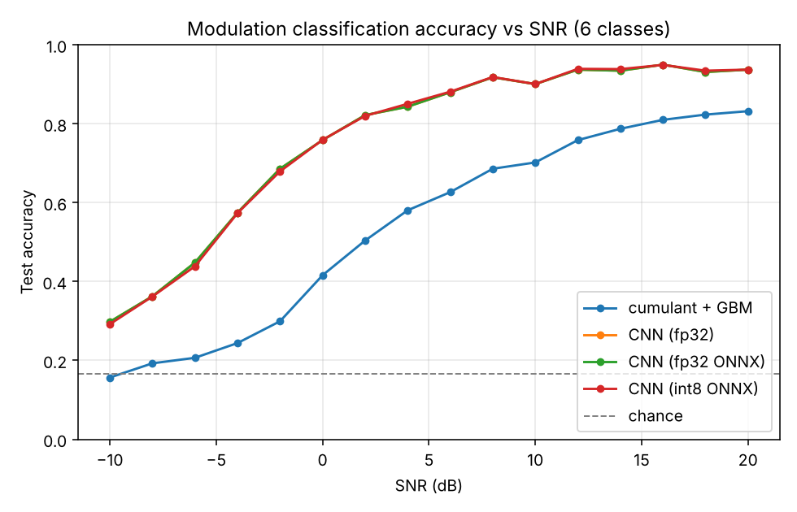

# Results

Generated by `rfmc report`. All numbers are on the held-out test split.

## Headline

| Model | Overall | SNR >= 10 dB | Size | p50 latency |
|---|---:|---:|---:|---:|
| cumulant + GBM | 0.5391 | 0.7856 | - | - |
| CNN (fp32) | 0.7614 | 0.9319 | - | - |
| CNN (fp32 ONNX) | 0.7614 | 0.9319 | 443 KB | 0.40 ms |
| CNN (int8 ONNX) | 0.7610 | 0.9333 | 130 KB | 0.10 ms |

## Accuracy vs SNR

| SNR (dB) | cumulant + GBM | CNN (fp32) | CNN (fp32 ONNX) | CNN (int8 ONNX) |
|---:|---:|---:|---:|---:|
| -10 | 0.157 | 0.298 | 0.298 | 0.292 |
| -8 | 0.193 | 0.363 | 0.363 | 0.362 |
| -6 | 0.207 | 0.448 | 0.448 | 0.439 |
| -4 | 0.244 | 0.575 | 0.575 | 0.573 |
| -2 | 0.299 | 0.686 | 0.686 | 0.679 |
| +0 | 0.416 | 0.759 | 0.759 | 0.759 |
| +2 | 0.504 | 0.822 | 0.822 | 0.820 |
| +4 | 0.581 | 0.843 | 0.843 | 0.851 |
| +6 | 0.627 | 0.880 | 0.880 | 0.881 |
| +8 | 0.686 | 0.918 | 0.918 | 0.919 |
| +10 | 0.702 | 0.901 | 0.901 | 0.901 |
| +12 | 0.759 | 0.937 | 0.937 | 0.939 |
| +14 | 0.787 | 0.935 | 0.935 | 0.939 |
| +16 | 0.810 | 0.950 | 0.950 | 0.949 |
| +18 | 0.823 | 0.931 | 0.931 | 0.935 |
| +20 | 0.832 | 0.937 | 0.937 | 0.937 |

